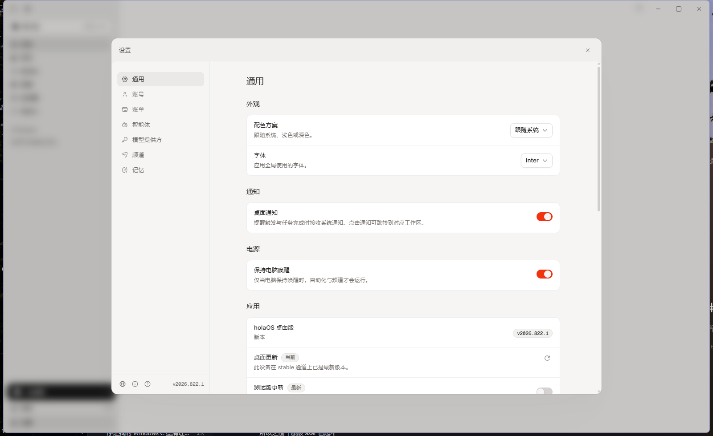
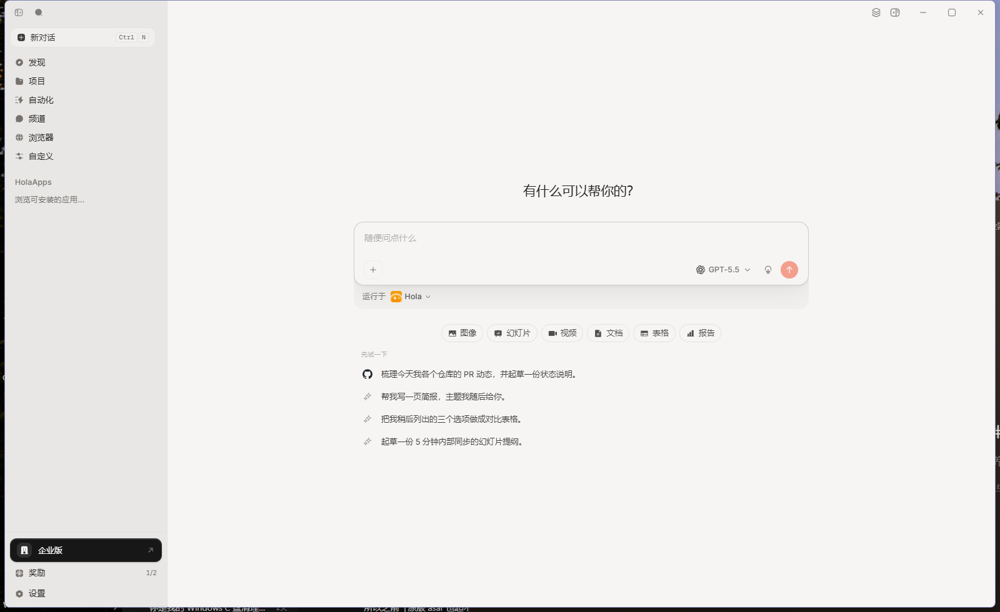
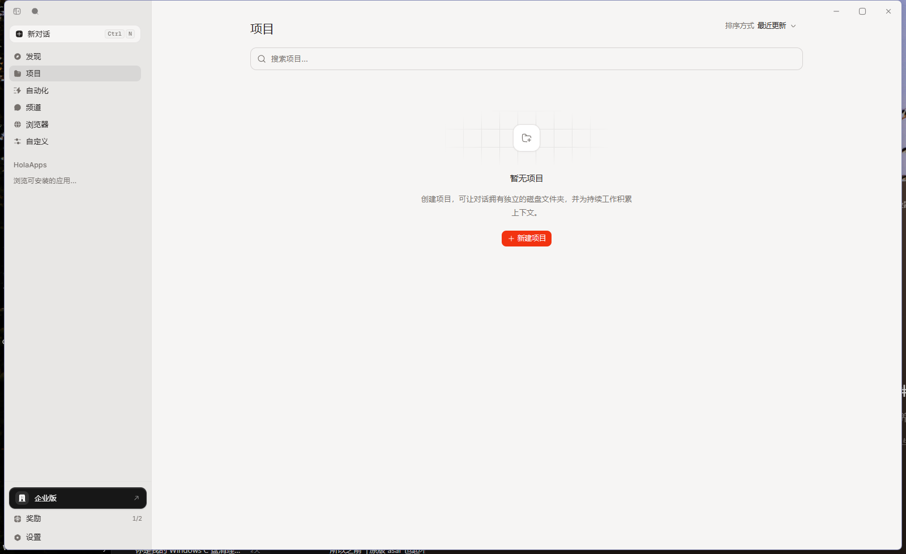
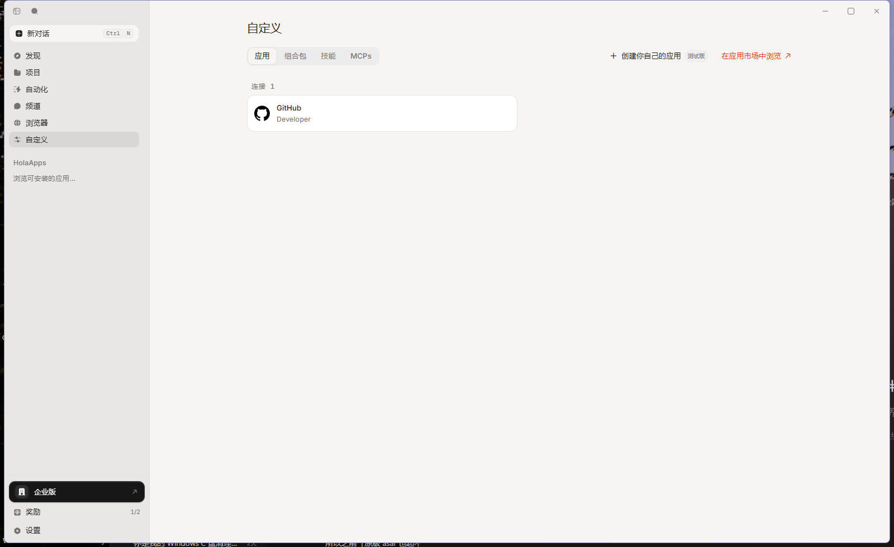

# holaOS 简体中文包

给 [holaOS](https://github.com/holaboss-ai/holaOS)（Electron 桌面客户端）用的**中文界面补丁**。

官方仓库没有 i18n 基础设施（无 `locales/`、无 i18next/react-intl 依赖、无 `zh-CN.json`，
issue 区 `i18n` / `localization` 均为 0 条），社区也没有现成汉化包。所以这里用另一条路：
**在自己的机器上，把客户端里打包好的界面文案替换成中文**，产出一个打过补丁的 `app.asar`。

- 不重打包、不修改任何原生模块（134 个 `unpacked` 文件原样保留）
- 不动服务器内容，纯本地静态替换
- 一条命令安装，一条命令回滚

| 设置 | 新建对话 | 项目 |
|---|---|---|
|  |  |  |



## 一键安装

**方式 A：下载本仓库，双击运行**

```powershell
# 在解压后的目录里
powershell -ExecutionPolicy Bypass -File .\install.ps1
```

**方式 B：一行命令（不需要手动下载）**

```powershell
powershell -ExecutionPolicy Bypass -Command "iwr https://raw.githubusercontent.com/SuJan1998/holaos-zh/main/install.ps1 -OutFile $env:TEMP\holaos-zh-install.ps1; & $env:TEMP\holaos-zh-install.ps1"
```

要带参数就接在后面，例如先预编译包试试：

```powershell
powershell -ExecutionPolicy Bypass -Command "iwr https://raw.githubusercontent.com/SuJan1998/holaos-zh/main/install.ps1 -OutFile $env:TEMP\holaos-zh-install.ps1; & $env:TEMP\holaos-zh-install.ps1 -Prebuilt"
```

> 为什么不用 `irm … | iex`：`install.ps1` 存的是 **UTF-8 with BOM**（Windows PowerShell 5.1
> 需要它才不把中文按 GBK 解码），而带 BOM 的文本走 `iex` 会因 BOM 出现在 `param()` 之前而报
> `Unexpected token 'param'`。落盘再 `&` 调用两个问题都没有。

安装脚本会：定位 holaOS → 备份原版 `app.asar` 为 `app.asar.orig` → 构建中文 asar → 结构校验 →
换入 → 启动。**不需要预装 Node**：没有 `node` 时用 `holaOS.exe` 自带的 Electron 运行时构建。

### 回滚

```powershell
powershell -ExecutionPolicy Bypass -File .\uninstall.ps1
```

或用原版安装包修复安装。

## 预编译包

不想本机构建（或构建失败）时，直接用 [Release](https://github.com/SuJan1998/holaos-zh/releases/tag/v2026.822.1) 里针对
**holaOS 2026.822.1** 编译好的 `app.zh.v7.asar`（504,054,705 B，约 480 MiB）：

```powershell
.\install.ps1 -Prebuilt          # 下载 + 校验 SHA256 + 安装
```

```text
app.zh.v7.asar
SHA256 b82366d45c56a3a444a343dfcb3258c1de355d0ea530fa6c4de16a6168c62fb5
```

也可以手动下载后用 `install.ps1 -AsarPath .\app.zh.v7.asar`，或按
[Release 说明](https://github.com/SuJan1998/holaos-zh/releases/tag/v2026.822.1) 里的步骤直接替换文件。

注意：预编译包只对应它标注的那个 holaOS 版本。holaOS 升级后请去掉 `-Prebuilt` 走本机构建，
或等新的 Release。

## 已汉化范围（基于 holaOS 2026.822.1）

- 侧栏全部：新对话 / 发现 / 项目 / 自动化 / 频道 / 浏览器 / 自定义 / HolaApps / 企业版 / 奖励 / 设置
- 设置面板全部条目（通用 / 账号 / 账单 / 智能体 / 模型提供方 / 频道 / 记忆 / 外观 / 通知 / 电源 / 应用）
- 新建对话页：占位符、建议提示、快捷卡片（图像 / 幻灯片 / 视频 / 文档 / 表格 / 报告）
- 项目页、自定义页、各类空态与错误提示
- 文档 / 表格 / 幻灯片内嵌编辑器（Univer）界面
- 原生窗口菜单与对话框（`main.cjs`）

规模：**1152 条单词条 + 61 条插值模板**，命中 11 个 bundle、约 1400 处替换。

### 改不到的部分（不是漏翻）

| 内容 | 原因 |
|---|---|
| HolaHub 市场页（Recipes / Marketplace / Sign in / Terms） | 内嵌**远程网页**，由服务端下发 |
| `+100 credits`、`Publish` 等奖励/市场文案 | 服务端返回的数据 |
| 模型名、渠道名、字体名、主题名、语言名 | 品牌与标识符，按设计保留英文 |

## 工作原理

holaOS 的界面全部打包在 `resources\app.asar` 里的 `out/dist/assets/*.js`（Vite/esbuild 产物，
字符串字面量统一用反引号）。补丁流程：

1. 解析 asar 头（前 8 字节 magic+长度，之后 pickle 内含 header JSON）
2. 从数据区尾部**追加**改动后的 chunk，只改写这些条目的 `offset` / `size` / `integrity`
   —— 其余 4.8 万个条目偏移全不变，`unpacked` 标志与 `.node`/`.dll` 位置原样保留
3. 替换用**字面量全量替换**（对每个词拼 `` `词` `` / `"词"` / `'词'` 三种 needle 做 split/join）。
   用正则配对反引号会在嵌套模板字符串 `` `${a?`b`:`c`}` `` 里错位 —— 实测 `` `Cancel` `` 35 处只换掉 4 处
4. 带 `${...}` 插值的整条模板单独放在 `dict/templates/`，占位符个数必须一致
5. 每个改动后的文件再过一遍 `node --check`，asar 做全量结构 + integrity 校验

## 目录结构

```
install.ps1              # 一键安装（含构建）
uninstall.ps1            # 回滚
build.ps1                # 只构建，不安装
tools/
  zh-build.mjs           # 构建器：asar 原地修补 + 词典替换
  zh-verify.mjs          # 校验：range / integrity / 中文字段统计
  asar-fullverify.mjs    # 全量 integrity 校验（约 1 秒）
  asar-x.mjs             # 从 asar 里按路径取单个文件
  leftover.mjs           # 淘词：列出「补丁后仍为英文」的候选（迭代主力）
  harvest2.mjs           # 淘词：按噪声规则筛裸字面量
  anchor-harvest.mjs     # 淘词：只扫属性位（children/label/title/…）
  legacy/                # 早期探针脚本，仅存档
dict/
  00-mvp.json 01-ui.json 10..13-anchors-*.json 20-extra.json 30-chat.json
  templates/01-tpl.json
docs/                    # 截图
```

构建产物默认缓存在 `%LOCALAPPDATA%\holaos-zh\app.zh.asar`，重复安装会复用；
用 `-Clean` 强制重建。

## 升级后要重做

holaOS 每次自动更新都会覆盖 `app.asar`，中文补丁随之失效。
新版本装好后重新跑一次 `install.ps1` 即可 —— 如果 `app.asar.orig` 已被新版覆盖，
先删掉它，脚本会重新备份新版原版：

```powershell
Remove-Item "$env:LocalAppData\Programs\holaOS\resources\app.asar.orig" -ErrorAction SilentlyContinue
.\install.ps1 -Clean
```

版本升级导致文案变化时，`install.ps1` 的构建日志会列出 `unused:` 词条 —— 那就是没命中的旧词，
按新文案更新 `dict/` 即可。

## 参与翻译

```powershell
# 1) 看还剩哪些英文（按频次排序）
node .\tools\leftover.mjs "$env:LocalAppData\holaos-zh\app.zh.asar"

# 2) 把确认为界面文案的条目翻好，写进 dict/40-xxx.json

# 3) 重建 + 安装
.\install.ps1 -Clean
```

写词表的两条规矩：

1. **只收纯显示文案**。替换是全局一致的（`` `Cancel` `` / `"Cancel"` / `'Cancel'` 全换），
   若某串同时是后端枚举值、路由或 map key，翻了会失配 —— 所以 `On` / `Off` / `None` /
   `Default` / `Auto` 这类状态词、语言名、主题名、HTTP 状态文本一律不收。
2. 带 `${...}` 的整条模板放 `dict/templates/`，占位符个数必须与原文一致。

## 常见问题

**装完启动不了 / 闪退，没有任何报错**
父进程带着 `ELECTRON_RUN_AS_NODE=1` 环境变量时，Electron 会以纯 Node 模式执行 `main.cjs`
然后立刻退出：exit 0、无窗口、无子进程、无日志、不写任何文件。启动前清掉它：

```powershell
Remove-Item Env:\ELECTRON_RUN_AS_NODE -ErrorAction SilentlyContinue
Start-Process "$env:LocalAppData\Programs\holaOS\holaOS.exe"
```

**会不会破坏自动更新 / 签名校验**
`EnableEmbeddedAsarIntegrityValidation` 在 Windows 上不生效，Electron 读 asar 时不校验 integrity。
改动条目的 integrity 仍然按 `blockSize=4194304` 重算过，`asar-fullverify.mjs` 全量校验 bad=0。
自动更新本身不受影响，但**更新会覆盖补丁**，升级后需重跑本脚本。

**支持 macOS / Linux 吗**
补丁算法本身与平台无关（`tools/zh-build.mjs` 是纯 Node 脚本），但安装脚本目前只写了 Windows。
macOS 最省事的是从 Release 下载 `app.zh.v7.asar`（版本要对得上）直接替换；
要自己构建则：

```bash
node tools/zh-build.mjs --src "/Applications/holaOS.app/Contents/Resources/app.asar" \
                        --out ./app.zh.asar --with-main
node tools/zh-verify.mjs ./app.zh.asar
# 备份后替换（应用需先完全退出）
```

---

## English

`holaOS-zh` is a community **Simplified-Chinese UI patch** for the holaOS desktop client.
Upstream has no i18n scaffolding (no `locales/`, no i18next/react-intl, zero `i18n` issues), so
this project patches the bundled renderer strings directly in your **own local install**:

```powershell
powershell -ExecutionPolicy Bypass -File .\install.ps1     # build + install + launch
powershell -ExecutionPolicy Bypass -File .\uninstall.ps1   # revert
```

It rewrites only display strings inside `resources\app.asar` (`out/dist/assets/*.js` plus
`out/dist-electron/main.cjs`), appending patched chunks at the tail of the data section and
rewriting just those entries' `offset`/`size`/`integrity` — no repack, native `.node`/`.dll`
modules untouched. Remote content (the embedded HolaHub marketplace page) and server-supplied
strings stay in English by design.

MIT licensed for the dictionary and scripts; holaOS itself belongs to IMERCH, INC. / the
Holaboss team, and no holaOS binary is redistributed here.
